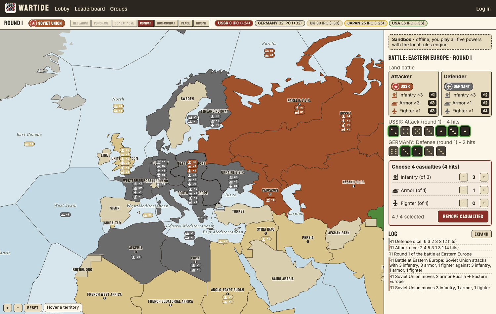

# Wartide

An online, play-by-web global WWII strategy game for 1–5 players (humans and computer
players), built almost entirely in Rust: a deterministic rules engine, an axum server, and a
Leptos/WASM web client. Game mechanics follow the 1986 classic five-power design exactly
(see `docs/RULES.md`); all artwork, names and text are original.



## Features
- Private games with friends (invite code; 5 power seats, any of them bots with distinct
  personas) and public ranked games (2-player Axis vs Allies, or 5-player) matched by rating.
- Play many games at once; configurable turn timeout (default 48 h) with bot takeover on expiry.
- Team / power / all chat; computer players talk strategy in team chat.
- Glicko-2 ladders: public 2p, public 5p, and per-group ladders. Private games are unrated.
- Groups with invite codes, roles and their own leaderboards. Profiles, streaks, recent games.
- Email-verified accounts, password reset, spectating public and finished games, replays.
- Offline sandbox at `/sandbox` running the full rules engine in the browser.

## Quick start (local sandbox)
```sh
source scripts/env.sh                 # toolchain paths (see CLAUDE.md)
just db-up                            # Postgres :5432 + Mailpit (mail UI at http://localhost:8025)
cp .env.example .env
just server                           # API + SPA on http://localhost:8080 (serves crates/web/dist)
# in another shell:
just web                              # trunk dev server on http://localhost:8081 with hot reload
```
Or run everything in containers: `docker compose --profile app up -d` then open http://localhost:8080.
Verification emails land in Mailpit.

## Repository layout
| Path | What |
|---|---|
| `crates/engine` | `wartide-engine`: pure rules engine (200+ tests, fuzzed, replayable, wasm-safe) |
| `crates/ai` | `wartide-ai`: heuristic computer player with persona-flavoured commentary |
| `crates/protocol` | serde DTOs shared by server and client |
| `crates/server` | axum + sqlx/Postgres: auth, lobby, matchmaking, ratings, groups, chat, bots, timeouts |
| `crates/web` | Leptos CSR client: SVG board, phase panels, battle board, chat, lobby, profiles |
| `infra/terraform` | AWS: ECS Fargate, RDS, ALB, SES, Secrets Manager, GitHub OIDC deploy role |
| `.github/workflows` | CI (fmt, clippy, tests, wasm build, image build) and deploy to ECS |
| `docs/` | RULES.md, ARCHITECTURE.md, DECISIONS.md, DEPLOY.md, ASSETS.md, screenshots |
| `scripts/mapgen` | Builds the original board geometry from public-domain Natural Earth data |

See `docs/DEPLOY.md` for AWS deployment and `CLAUDE.md` for conventions.
